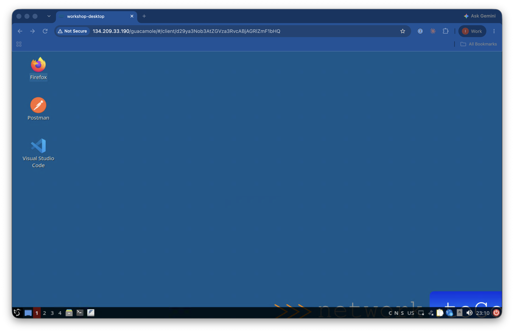
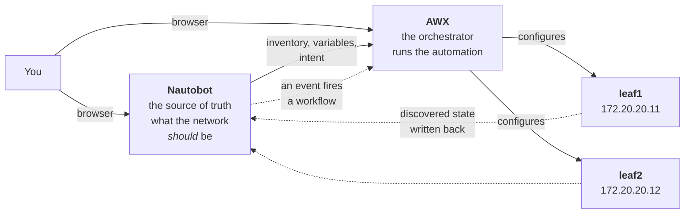

# Start here

**From Intent to Execution: Nautobot and Ansible, Better Together**

Welcome to this workshop, where we explore how Nautobot and Ansible can coexist, complement, and enhance each other.

You are going to have access to two repositories:
- [`nautobot-ansible-workshop-guide` ](https://github.com/networktocode/nautobot-ansible-workshop-guide.git)This is the current repository and has all the steps that you are going to follow as part of the workshop. Start here, review the README, and it will take you to each lab.
- [`nautobot-ansible-workshop`](https://github.com/networktocode/nautobot-ansible-workshop.git) This repository has all the files that are used in the different labs; we will explore it in detail as we move along.
---
**Getting access to the lab**

Everything you need is already running. You will not install anything. You will receive a URL and a set of credentials for your lab environment. Use those in your browser to access the virtual machine with everything you need. You should see the desktop of the virtual machine like this:

> The URL/IP in the image is just an example to show you how your browser is going to look like when you get there. But, you are going to receive your own address.
---

## You'll work in three places

Keep all three open. Every step in every lab is labeled with which one it means, so you never have to guess where to click or type.
| Icon | What it is | Where |
| --- | --- | --- |
| 🤖 **NAUTOBOT** | Browser tab. The source of truth — devices, IPs, variables, intent. | `https://NN.DOMAIN/nautobot` |
| ⚙️ **AWX** | Browser tab. The orchestration layer — job templates, inventories, workflows. | `https://NN.DOMAIN/awx` |
| 💻 **TERMINAL** | SSH session. Runs `ansible-playbook` and `ansible-inventory` by hand. | see below |

**🤖 is Nautobot's own robot, ⚙️ is the machinery that runs things, 💻 is your shell.** Once you have those three, you never need to read a step twice to work out where it happens.

Open the terminal with:

```
ssh admin@DOMAIN -p 22NN
```

Your attendee number is on your card. Wherever you see `NN`, use it.

> **Why a terminal at all, when AWX can run everything?** Because seeing the same playbook work from both places is the point. The terminal shows you *what* is happening; AWX shows you the same thing with credentials, logging and RBAC wrapped around it. **The playbook never changes between them.**

**Two browser tabs, one terminal.** You'll switch between them constantly — a lab will typically change something in Nautobot, prove it from the terminal, then show the same result in AWX.

## Credentials

**`admin` / `admin`. Everywhere. That's the whole table.**

| System | Username | Password |
| --- | --- | --- |
| Nautobot | `admin` | `admin` |
| AWX | `admin` | `admin` |
| Devices (`leaf1`, `leaf2`) | `admin` | `admin` |
| SSH | `admin` | `admin` |
Nothing to look up, nothing to remember; you can navigate freely between the different tools.

Already set for you in the terminal, so most commands just work:
| Variable | Value |
| --- | --- |
| `NAUTOBOT_URL` | `http://localhost:8001` |
| `NAUTOBOT_TOKEN` | `0123456789abcdef0123456789abcdef01234567` |
| `AWX_HOST` | `http://localhost:8013` |

## Your devices
| Device | IP | Platform |
| --- | --- | --- |
| `leaf1` | `172.20.20.11` | Arista cEOS 4.33.10M |
| `leaf2` | `172.20.20.12` | Arista cEOS 4.33.10M |
These are the real addresses — the same for every attendee in the room. You can copy and paste any command in the labs exactly as written.

---

## How the pieces fit together



**Solid arrows** are what exists at the start. **Dotted arrows** are what you'll build: writing discovered state back into Nautobot (Lab 3), and letting a change in Nautobot trigger automation (Lab 4).

---

## The four hours

| Time | What |
| --- | --- |
| 9:00–9:15 | **Cold open** — onboard a site the painful way |
| 9:15–9:55 | **Lab 1** — Nautobot as your inventory |
| 9:55–10:45 | **Lab 2** — variables and intent |
| 10:45–11:15 | **Break** |
| 11:15–11:55 | **Lab 3** — execute, and write state back |
| 11:55–12:40 | **Lab 4** — event-driven, with an approval gate |
| 12:40–13:00 | When NOT to use AWX · wrap and Q&A |

1. [Lab 0 — Cold open](./lab0-cold-open.md)
2. [Lab 1 — Nautobot as inventory](./lab1-inventory.md)
3. [Lab 2 — Variables and intent](./lab2-intent.md)
4. [Lab 3 — Execute and write back](./lab3-writeback.md)
5. [Lab 4 — Event-driven with an approval gate](./lab4-approval.md)

---

## How the labs are written

**One path through each lab, lettered a, b, c… — follow it in order.** Every step says which of the three places above it happens in, and every command and value is printed in full. You should never have to look anything up or guess.

Each lab then ends with **stretch goals** — several of them, harder, if you finish early and want to explore more on your own. They are genuinely optional. Nothing later depends on them, and you can come back after the session.

**Everything is pre-built.** You change settings — flip a dropdown, edit a field, press a button. You never have to write a file from scratch or push to git. That's deliberate: it keeps the session about the *ideas*, not about typing.

## If you get stuck

**Raise a hand.** There are proctors in the room, and being stuck for five minutes is five minutes not spent learning.

If your environment gets into a bad state, a proctor can **reset you to the start of any lab** in a minute or two — you won't lose your place in the session. Just ask; it's a normal thing to do, not a failure.

---

## Two things worth knowing before we start

**This is not really a workshop about AWX.** It's about the orchestration layer. Job templates, workflows, approval nodes, credentials and execution environments are the same objects in **Ansible Automation Platform** — if you run AAP at work, everything here applies directly. We use AWX in the lab only so that nobody needs an AAP license to attend.

**And yes — AWX hasn't had a tagged release since July 2024.** That looks like an abandoned project. It isn't. The AWX README states that releases are *"paused during a large scale refactoring"* toward a pluggable, service-oriented architecture, and development continues on the `devel` branch.

---

## Taking it home

Everything you build today is in a repository you keep and it includes the notes you'd need to rebuild this environment yourself. We have prepared an environment that is ready for you to start experimenting and learning but there is nothing there that you could not replicate on your own. We come back to it at the [end of Lab 4](./lab4-approval.md).

## Next step
Your are ready to start working. Jump to [lab0-cold-open.md](nautobot-ansible-workshop-guide/lab0-cold-open.md)  and start working your way through. Good luck and have fun!
