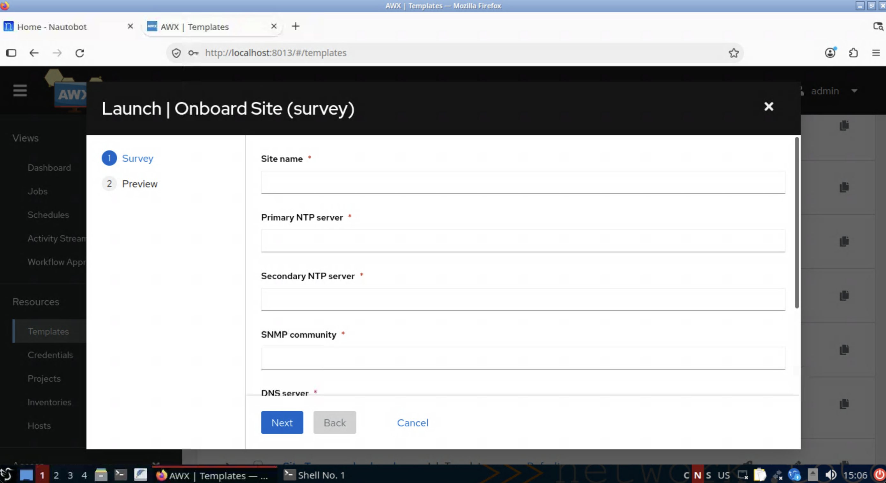

# Lab 0 — Cold open

## The situation

You run Ansible. It works. You have AWX, job templates, and playbooks in Git, all of it working.

A new site is coming online. Two switches, `leaf1` and `leaf2`, need base config: NTP, DNS, SNMP, syslog.

**Go do it.** The job template already exists.

---

## Do this

1. Open **AWX** at [`http://localhost:8013`](http://localhost:8013) and log in as `admin` / `admin`
2. **Resources → Templates → `Onboard Site (survey)`**
3. Click the **rocket icon** 🚀 to launch
4. Fill in all six survey fields:


| Field | Value |
| --- | --- |
| Site name | `DC1` |
| Primary NTP server | `10.0.0.1` |
| Secondary NTP server | `10.0.0.2` |
| SNMP community | `public` |
| DNS server | `10.0.0.53` |
| Syslog host | `10.0.0.10` |
5. **Launch.** Watch it run.

It works. Both devices are configured.

## Check it on the devices

Don't take the job's word for it. 💻 **In your terminal**, log in to `leaf1` — the password is `admin`:

```bash
ssh admin@172.20.20.11
```

You're now on an Arista switch. Show just the lines the job added:

```
show running-config | include ntp|name-server|snmp-server|logging host
```

You should see the values you typed into the survey: two NTP servers, the DNS server, the SNMP community and the syslog host. Type `exit` to leave, then do the same on `leaf2`:

```bash
ssh admin@172.20.20.12
```

---

## Now think about what just happened

You typed six values into a form.

**Every single one of them is already recorded in Nautobot.** Open it and look at [`http://localhost:8001`](http://localhost:8001), logging in as `admin` / `admin`. The site is there. The devices are there. The NTP servers are there.

So you just hand-copied data from a system of record into a form to configure devices that the same system of record already knows about.

**Some questions worth sitting with:**

- What happens when the NTP servers change? Who updates the survey defaults?
- What if you'd typed `10.0.0.11` instead of `10.0.0.1`? What would have caught it?
- Where does `leaf1`'s IP address come from? Have a look at `inventory/static.ini` in the project repo — someone maintains that by hand.
- It's six fields for two devices. What does it look like for forty devices and a dozen fields?

**Nothing here is broken.** That's the uncomfortable part. This setup is automated; it's in version control; it runs from an orchestrator with logs and RBAC. It's better than most.

It's just disconnected. The automation platform and the source of truth don't talk to each other, so a human is the integration — retyping, remembering, and occasionally mistyping.

---

## Where we're going

Over the next three and a half hours, you'll take that apart piece by piece:
| Lab | What disappears |
| --- | --- |
| **1** | The static inventory file. Nautobot becomes the inventory. |
| **2** | The survey and `group_vars`. Nautobot supplies the variables. |
| **3** | The one-way street. Devices start writing state *back* to Nautobot. |
| **4** | The manual launch. A change in Nautobot triggers automation — behind an approval gate. |
**The playbook itself never changes.** Not once, in any of the four labs. That's the point: this isn't about rewriting your automation; it's about connecting it to what you already know.

---

## Before you move on

Have a quick look at the project repo so the later labs feel familiar. 💻 **In your terminal:**

```bash
cd ~/nautobot-ansible-workshop && ls -R
```

Three things to notice:

- `inventory/static.ini` — two hosts, hand-maintained. Lab 1 deletes it.
- `inventory/group_vars/leaf.yml` — the variables the survey duplicates. Lab 2 deletes it.
- `playbooks/configure_base.yml` — the playbook. Read it now, because it's the last time it changes.

Everything else is scenery for today: `awx/` and `ee/` are how your environment was built, `clab/` describes the two switches, and `graphql/`, `jobs/` and `templates/` come into play in Labs 2, 3 and 4. Nothing to read yet.

---

➡️ [Lab 1 — Nautobot as inventory](./lab1-inventory.md)
