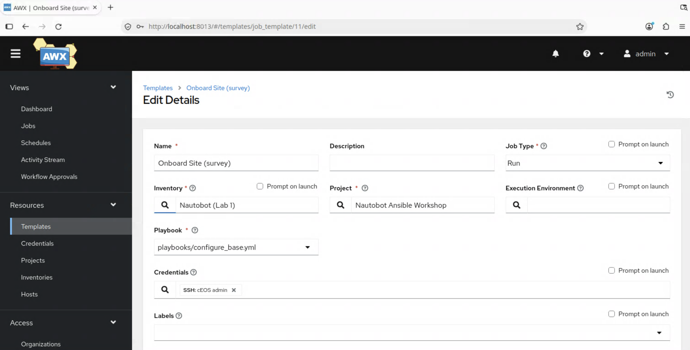
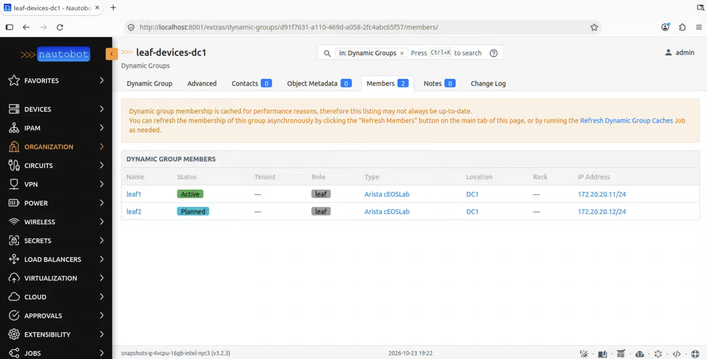

# Lab 1 — Nautobot as your inventory

**40 minutes.** Goal: delete the static inventory file and let Nautobot decide which devices exist and where they are.

By the end, you'll run the same playbook against an inventory that comes live from Nautobot and make a change in Nautobot that changes what automation targets, without editing anything in AWX.

---
> **Where you'll be working.** 🤖 Nautobot · 💻 Terminal · ⚙️ AWX — every step below says which. Keep all three open; this lab moves between them multiple times.
---

## 1a. 🤖 Nautobot — look at what it already knows

**Devices → Devices**. You should see leaf1 and leaf2.

Click `leaf1`. Note:

- **Location** — DC1
- **Role** — leaf
- **Platform** — Arista EOS
- **Primary IP** — `172.20.20.11`

Every one of those is something your inventory file also claims to know. Right now, there are two copies, and only one is the source of truth.

## 1b. 💻 Terminal — the two inventories side by side

```bash
cd ~/nautobot-ansible-workshop
```

The old way — hand-maintained:

```bash
cat inventory/static.ini
```

The new way:

```bash
cat inventory/nautobot.yml
```

Notice what isn't in that file: no hostnames, no IP addresses. It's a set of instructions for asking Nautobot. It also has no URL or token; those come from the environment, which is why the same file works both here and inside AWX.

## 1c. 💻 Terminal — prove it works

```bash
ansible-inventory -i inventory/nautobot.yml --graph
```

```
@all:
  |--@ungrouped:
  |--@dc1:
  |  |--leaf1
  |  |--leaf2
  |--@leaf:
  |  |--leaf1
  |  |--leaf2
  |--@arista_eos:
  |  |--leaf1
  |  |--leaf2
```

**Three groups, and nobody wrote any of them down.** `dc1` is the location, `leaf` the role, `arista_eos` the platform — each one a field on the device record in Nautobot, turned into an Ansible group automatically.

`leaf` is the one that matters right now: it's how the variables in `inventory/group_vars/leaf.yml` still find their hosts. Same group name as the static inventory used, which is why nothing downstream had to change.

> Ignore the two `PARAMIKO_...` deprecation warnings above the output. They're upstream noise about a config option that moves in a future Ansible release, and they appear on most commands in this workshop.

Look at a single host:

```bash
ansible-inventory -i inventory/nautobot.yml --host leaf1
```

Everything there came from Nautobot. `ansible_host` was built from the device's primary IP.

## 1d. 💻 Terminal — the payoff, same playbook

Before you run the **`Onboard Site (survey)`**, that was the UI view of the `configure_base.yml` playbook. In this case, we run the same playbook but from the CLI so that you can appreciate that what we are doing is changing the inventory source.

```bash
ansible-playbook -i inventory/nautobot.yml playbooks/configure_base.yml -u admin -k --check --diff
```

Password: `admin`

The playbook did not change. Only the `-i` argument did. That's the whole argument for a source of truth, in one command. This means that you are able to use your Ansible scripts with a single inventory.

## 1e. ⚙️ AWX — make the orchestrator use it

Same switch, now in the orchestrator.

1. **Resources → Templates → `Onboard Site (survey)`**
2. Click **Edit**
3. Change **Inventory** from `Static (Lab 0)` to `Nautobot (Lab 1)`
4. **Save**, then **Launch** 🚀
5. **The survey still appears.** Fill it in with the same values as in Lab 0.



You changed one field, **Inventory**. Same playbook, same project, same credentials.

The survey is expected when you launch: you changed only *where the devices come from*. The values are still typed in by you; Lab 2 moves them into Nautobot.

## 1f. 🤖 Nautobot — decide *which* devices

An inventory says what exists. A **Dynamic Group** says which subset you care about, and it's a *saved filter*, not a hand-maintained list.

1. **Organization → Dynamic Groups**
2. Open `leaf-devices-dc1`
3. Look at its filter — role `leaf`, location `DC1`
4. Click **Members**. Both devices.



Nothing was added by hand. Any device matching that filter is a member, always.

Now use it — 💻 **back to the terminal**:

```bash
ansible-playbook -i inventory/nautobot.yml playbooks/target_dynamic_group.yml -e dynamic_group_name="leaf-devices-dc1" -u admin -k
```

It asks Nautobot who's in the group, then acts on exactly those devices.

## 1g. The bit that makes the point

🤖 **In Nautobot — change the filter:**

1. Edit `leaf-devices-dc1`
2. In the filter, set **Status** to `Active`, keeping role `leaf` and location `DC1`. `leaf1` is Active; `leaf2` is still Planned, waiting to be turned up.
3. **Save**
4. On the group's page, run **Refresh Members**. Nautobot stores each group's member list, and this recalculates it from the new filter. Without it, the members don't change yet.
5. Check **Members** now shows only `leaf1`

💻 **In the terminal — re-run the exact same command:**

```bash
ansible-playbook -i inventory/nautobot.yml playbooks/target_dynamic_group.yml -e dynamic_group_name="leaf-devices-dc1" -u admin -k
```

This time it runs on `leaf1` only. **You didn't touch Ansible, the playbook, or AWX.** You changed your mind in the source of truth and the automation followed.

When you're done, edit `leaf-devices-dc1` again, clear the **Status** filter, save, and run **Refresh Members**, so both devices are members again.

---

## What just changed

| Before | After |
| --- | --- |
| `inventory/static.ini`, hand-maintained | Nautobot, live |
| A new device means editing a file and pushing | A new device in Nautobot is just *there* |
| "Which devices?" answered in Ansible | Answered in the source of truth |

`inventory/static.ini` is now dead weight. **Lab 2 deletes `group_vars` too.**

---

## Stretch goals

Pick whichever appeals — all optional.

> 💻 **All of these run from the repo**, so start with `cd ~/nautobot-ansible-workshop` if you have wandered off.

**1. Group by something else.** Edit `inventory/nautobot.yml` and add `status` or `tenant` to `group_by`, then re-run:

```bash
ansible-inventory -i inventory/nautobot.yml --graph
```

What new groups appear?

**2. Filter the inventory itself.** The bottom of `inventory/nautobot.yml` has a commented-out `device_query_filters` block — uncomment its two lines, changing nothing else, so only Active devices appear. Set a device to Planned in Nautobot and watch it drop out of the inventory entirely, not just out of a group.

**3. Add a third device to Nautobot** — no container behind it, just the record. Watch it appear with no file edited anywhere:

```bash
ansible-inventory -i inventory/nautobot.yml --graph
```

**4. Read the plugin's options:**
```bash
ansible-doc -t inventory networktocode.nautobot.inventory
```

---

## Stuck?

Raise a hand and a proctor will come over.

| Symptom | Likely cause |
| --- | --- |
| `--graph` shows no hosts | Nautobot devices missing a primary IP, or status not Active |
| Group is `role_leaf`, not `leaf` | Inventory plugin naming options — ask a proctor |
| Playbook can't connect | Device password is `admin`; check with `ssh admin@172.20.20.11` |
| AWX sync fails | Ask a proctor — it's a network path issue, not you |

---

⬅️ [Lab 0](./lab0-cold-open.md) · ➡️ [Lab 2 — Variables and intent](./lab2-intent.md)
