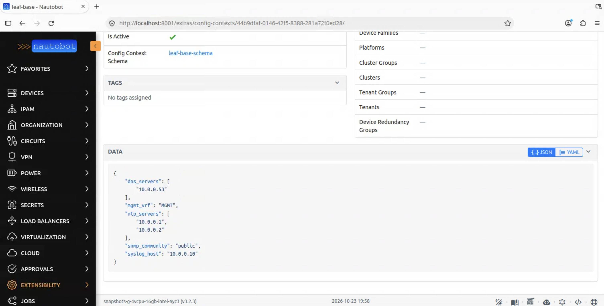
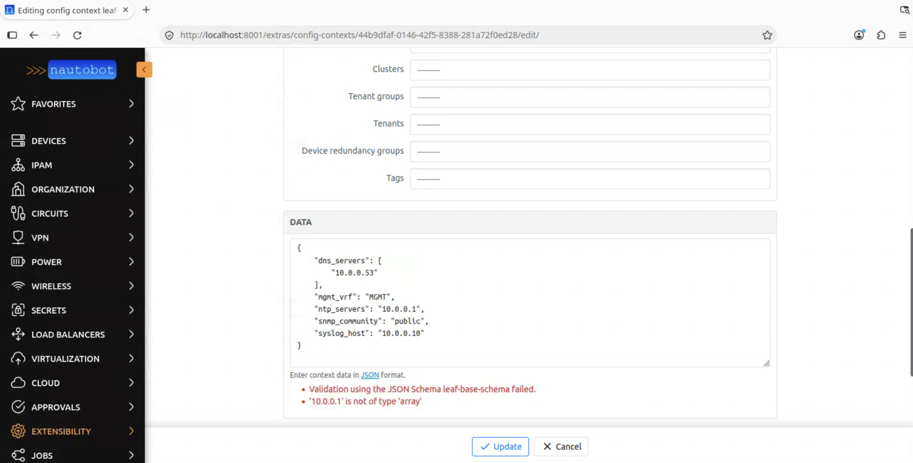
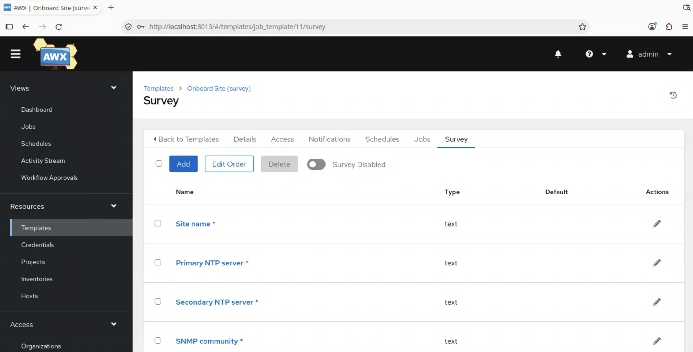

# Lab 2 — Variables and intent

**40 minutes.** Goal: delete `group_vars` and let Nautobot hold the variables validated and fetched in a single query.

By the end, you'll have deleted the last local copy of your device data, watched Nautobot reject a bad value before it could reach a device, and rendered a full config from one GraphQL query.

> **Where you'll be working.** 🤖 Nautobot · 💻 Terminal, and ⚙️ AWX for the last step only — every step below says which. Almost everything here is about what the source of truth knows, before an orchestrator is involved.

---

## 2a. 💻 🤖 Where the variables live now

💻 Look at the local copy first:

```bash
cd ~/nautobot-ansible-workshop && cat inventory/group_vars/leaf.yml
```

NTP servers, DNS, SNMP community, syslog host. These are the same six values you typed into the survey in Lab 0. Third copy, if you're counting: survey, file, and, as you're about to see, Nautobot.

🤖 Now open Nautobot → **Extensibility → Config Contexts** → `leaf-base`.



Same keys, same values. But note the scope: it applies to devices with role `leaf`. It isn't attached to a device, it's attached to a *rule*. Any new leaf gets it automatically.

## 2b. 💻 Terminal — it's already reaching your playbook

```bash
ansible-inventory -i inventory/nautobot.yml --host leaf1 | jq '.ntp_servers'
```

Those came from Nautobot, not from the file. The inventory plugin pulls Config Contexts and puts the keys directly onto the host.

So right now you have two sources saying the same thing, and Nautobot is already winning, because inventory data outranks `group_vars`.

## 2c. 💻 Terminal — delete the local copy

```bash
rm inventory/group_vars/leaf.yml
```

```bash
ansible-playbook -i inventory/nautobot.yml playbooks/configure_base.yml -u admin -k --check --diff
```

Same result. Same playbook, same template, no `group_vars` at all.

> `inventory/group_vars/all.yml` stays — that's connection plumbing (`ansible_connection`, `ansible_become`), which is Ansible mechanics rather than anything about your network. Different kind of thing, different home.

## 2d. 🤖 Nautobot — now make bad data impossible

A file can hold anything. A source of truth can refuse.

🤖 **Extensibility → Config Context Schemas** → `leaf-base-schema`. It's JSON Schema: `ntp_servers` must be an array of at least one IPv4 string.

Try to break it. Edit the `leaf-base` Config Context and change:

```json
"ntp_servers": ["10.0.0.1", "10.0.0.2"]
```

to a plain string:

```json
"ntp_servers": "10.0.0.1"
```

Save. Nautobot rejects it.



That's the part worth pausing on. In Lab 0, you'd have typed the same mistake into a survey, accepted it without comment, and pushed it to a device. Here it never leaves the source of truth.

Put it back the way it was.

## 2e. 🤖 Nautobot — one query for everything

So far you've been getting variables. But a device is more than variables — it has interfaces, IPs, a platform, a role, a location.

Nautobot ships an interactive query browser called **GraphiQL**.

Look at the very bottom of the Nautobot window. There's a thin toolbar of icons; hover over them, and you'll find Theme · Docs · Jinja Renderer · API · GraphQL · Code · Help. Click the GraphQL one.

> It's icon-only with tooltips, and easy to scroll past. Those seven are worth knowing about generally — **Jinja Renderer** and **API** are genuinely useful, and none of them are in the left-hand navigation.

Paste this into the left-hand pane and press the ▶ button:

```graphql
query {
  devices(name: ["leaf1"]) {
    name
    role { name }
    location { name }
    config_context
    interfaces {
      name
      ip_addresses { address }
    }
  }
}
```

One request. With the REST API, that's a device call, then a role call, then a platform call, then interfaces, then IPs for each. Here, it's one round trip that returns exactly the shape you asked for.

> Saved queries live elsewhere — Nautobot → **Extensibility → GraphQL Queries**, under *Data Management*. That's where `device_intent` is stored, the one `render_intent.yml` uses in the next step. GraphiQL is for exploring; a saved query is for automation to call by name.

## 2f. 💻 Terminal — render a config from it

```bash
ansible-playbook -i inventory/nautobot.yml playbooks/render_intent.yml
```

```bash
cat rendered/leaf1.cfg
```

Everything in that file came from that single query. No `group_vars`, no survey, no static inventory.

> This one needs no device credentials — it only reads Nautobot and writes a local file. Your switches could be switched off.

## 2g. 💻 Terminal — compare intent against reality

Rendering is one thing. Knowing whether the device *agrees* is another.

```bash
ansible-playbook -i inventory/nautobot.yml playbooks/diff_intent.yml -u admin -k --diff
```

Password: `admin`

Probably: `NO DRIFT — device matches Nautobot intent`. Correct, but dull.

So create some drift in Nautobot. Edit the `leaf-base` Config Context and add a third NTP server:

```json
"ntp_servers": ["10.0.0.1", "10.0.0.2", "10.0.0.3"]
```

Re-run the exact same command:

```bash
ansible-playbook -i inventory/nautobot.yml playbooks/diff_intent.yml -u admin -k --diff
```

The new line appears in the diff.

Nothing was pushed. Check mode is the default here — you're seeing what *would* change. You changed your mind in the source of truth, and the gap between intent and reality became visible immediately.

## 2h. ⚙️ AWX — the same job, without the survey

The values now live in Nautobot, so the Lab 0 survey has nothing left to do.

1. **Resources → Templates → `Onboard Site (survey)`**
2. Open the **Survey** tab and switch the survey **off**
3. **Launch** 🚀 — no form this time



Read the job output: it pushes `ntp server 10.0.0.3` to both devices, the server you added in Nautobot in 2g. Nobody typed it. The same job template that needed six values in Lab 0 now gets them from the source of truth.

💻 **Check it on the device**, as you did in Lab 0. The password is `admin`:

```bash
ssh admin@172.20.20.11
```

```
enable
```

```
show running-config | include ntp
```

Three NTP servers now, where Lab 0 left two. The third, `10.0.0.3`, exists only in Nautobot: you never typed it into a survey or a file. Type `exit` to leave.

Run the 2g diff again, and it's back to `NO DRIFT`: the device and the source of truth agree.

---

## What just changed

| Before | After |
| --- | --- |
| Variables in a file, and in a survey | Variables in Nautobot, once |
| Any value accepted | Schema rejects bad data at the source |
| Many API calls to assemble a device | One GraphQL query |
| "Is the device right?" — unknown | A diff, on demand |

Two of the three copies are gone. Lab 3 reverses the flow entirely.

---

## Stretch goals

**1. Scope a context more narrowly.** Create a second Config Context for `leaf1` only — a different `syslog_host`. Which wins? Nautobot shows the merged result on the device's **Config Context** tab.

**2. Tighten the schema.** Add a `pattern` requiring `snmp_community` to be at least 8 characters. Watch `public` become invalid.

**3. Extend the query.** In GraphiQL, use the **Docs** panel (top right) to explore the schema. Add `tags`, or `interfaces { description }`. The docs panel is generated from the schema — it always matches your Nautobot.

**4. Add the new field to the template.** `templates/full_config.j2` renders from the query result. Add something you just pulled in, and re-run `render_intent.yml`.

---

## Stuck?

| Symptom | Likely cause |
| --- | --- |
| `jq '.ntp_servers'` returns `null` | Config Context not scoped to role `leaf`, or `flatten_config_context` off — ask a proctor |
| Playbook fails after deleting `group_vars` | Check you deleted `leaf.yml`, not `all.yml` |
| Schema doesn't reject bad data | The schema may not be linked to the context — check its **Schema** field |
| GraphQL returns empty `devices` | Device name is case-sensitive |
| Diff is empty | Correct if nothing changed — go make drift in Nautobot (2g) |

---

⬅️ [Lab 1](./lab1-inventory.md) · ➡️ [Lab 3 — Execute and write back](./lab3-writeback.md)
