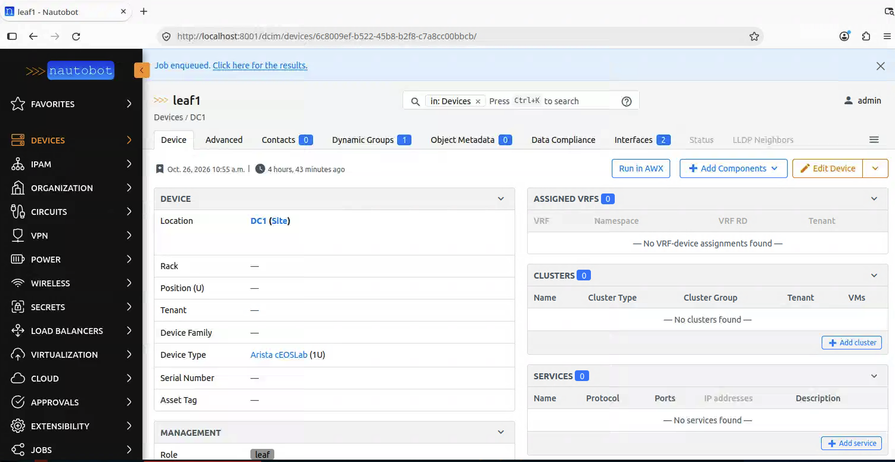
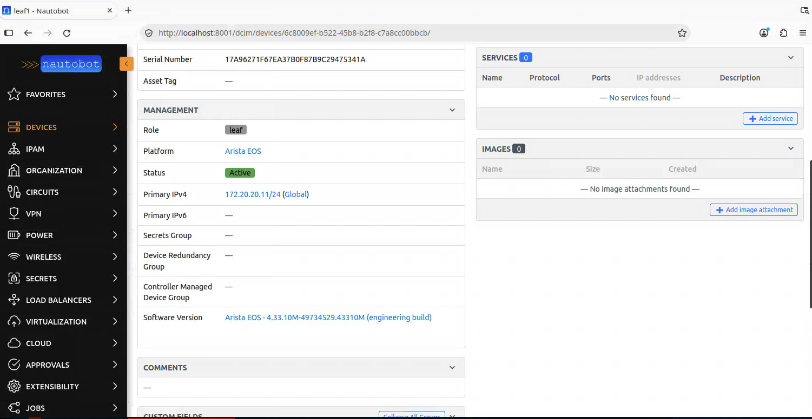
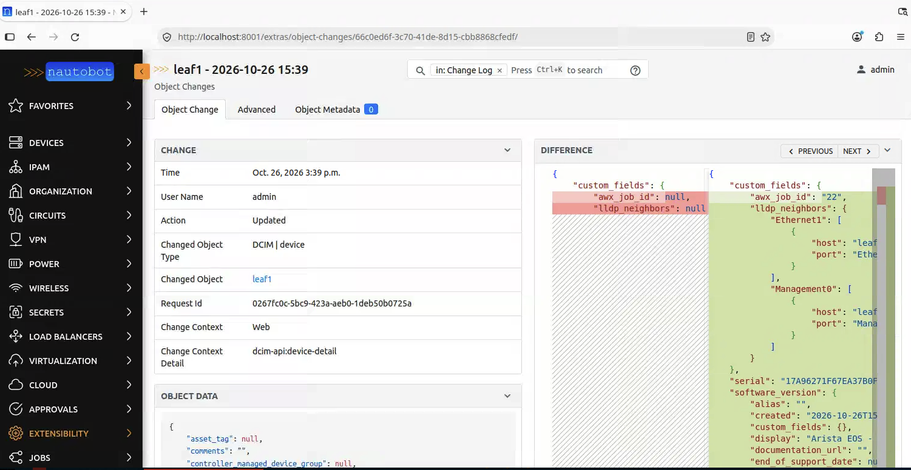

# Lab 3 — Execute and write state back

**45 minutes.** Goal: reverse the flow. Until now, everything moved Nautobot → device. Now the device tells Nautobot what's actually true.

By the end, you'll have launched automation from a device page in Nautobot, written discovered state back into the source of truth, and found the change log entry naming the job that caused it.

> **Where you'll be working.** 🤖 Nautobot · 💻 Terminal · ⚙️ AWX — every step below says which. This is the most Nautobot-heavy lab; you'll only need AWX to watch what Nautobot launched.

---

## 3a. 🤖 Nautobot — launch from where the data lives

Everything so far started in a terminal or in AWX. But the person who wants a device configured is usually *looking at that device* in Nautobot.

🤖 **Devices** → click `leaf1`. Top right: **Run in AWX**. Click it.



Follow the "**Job equeued. Click here for the results**" link at the top left of the page.

You'll land on a **Job Result** page. Read the log — it looks up the template by name, posts to AWX, and prints the AWX job ID and a link.

⚙️ **Follow the link.** It takes you into AWX. That's a real AWX job, launched from Nautobot, targeting the device whose page you were on, and it ran on AWX's own infrastructure, not in your terminal.

## 3b. 🤖 Nautobot — what that button actually is

Not a hyperlink. It ran a Nautobot Job, server-side Python with the full Nautobot ORM available.

That distinction matters, and it's worth knowing before the closing segment:

| Capability | Job Button | A plain link to AWX |
| --- | --- | --- |
| Runs code | ✅ | ❌ |
| Can validate before launching | ✅ | ❌ |
| Leaves a record in Nautobot | ✅ Job Result + logs | ❌ |
| RBAC on who may press it | ✅ | ❌ |

Nautobot has its own automation engine. Sometimes that's the right place for logic; that is a point we'll come back to at the end of the session.

Have a look: 🤖 **Jobs → Launch AWX job for this device**. The source is in the lab repo under `jobs/`.

## 3c. Who should own the password?

**🤖 + ⚙️ — you'll need both browser tabs for this one.**

Both systems can hold device credentials, and it is an important design decision for your environment:

🤖 **Nautobot Secrets Groups** — **Extensibility → Secrets**, then **Secrets Groups**. Nautobot holds a *reference* to a secret (environment variable, file, Vault, AWS Secrets Manager) and binds it to a device.

⚙️ **AWX Credentials** — **Resources → Credentials**. AWX holds the secret, injects it at runtime, and never exposes it.

Look at both now, side by side.

| Use | When |
| --- | --- |
| **AWX Credentials** | AWX is the only consumer; you want RBAC on the credential; you'd rather Nautobot never touch secrets |
| **Nautobot Secrets Groups** | Many consumers need the same per-device credential — Nornir, Golden Config, Nautobot Jobs, *and* AWX — and you want the binding modeled next to the device |
| **Both** | The common failure. Two sources, one silently stale. |

There's no universal right answer, but there is a wrong one: maintaining both and assuming they agree.

*This lab uses an AWX Machine credential. The Secrets Group exists so you can see the shape of the alternative.*

## 3d. 💻 Terminal — now reverse the flow

Every playbook so far has pushed. This one asks the device what's true and records it.

```bash
cd ~/nautobot-ansible-workshop
```

```bash
ansible-playbook -i inventory/nautobot.yml playbooks/write_back.yml -u admin -k
```

Password: `admin`

It gathers facts, then writes back:

| From the device | Into Nautobot |
| --- | --- |
| Serial number | `Device.serial` |
| EOS version | `Device.software_version` |
| LLDP neighbours | `lldp_neighbors` custom field |
| The job that did it | `awx_job_id` custom field |

## 3e. 🤖 Nautobot — look at what changed

🤖 **Devices → `leaf1`**.

- **Serial** — populated from the device
- **Software Version** — a real object now, not free text
- Scroll to **Custom Fields** — `AWX Job ID` and `LLDP Neighbors`



Nobody typed any of this. The device reported it, and the source of truth recorded it.

> If **Serial** is blank, that's normal — containers often don't have one. If **LLDP Neighbors** is `{}`, LLDP may be off on these images. Neither is a failure; the playbook prints what it found.

## 3f. 🤖 Nautobot — the audit trail

This is the part that matters for anyone with a change process.

🤖 **Extensibility → Change Log**. Open the newest entry for `leaf1`.

You get:

- **What changed** — field-level diff, before and after
- **When**
- **Who** — the user behind the API token
- `awx_job_id` — the job that caused it



From a change in your source of truth, you can name the automation run that caused it. That link is the thing auditors ask for, and most setups can't produce.

Lab 4 completes the circle: the *trigger* also becomes part of the record.

---

## What just changed

| Before | After |
| --- | --- |
| Nautobot → device, one way | Both directions |
| Nautobot's data is what someone typed | Reflects what the devices reported |
| "Who changed this?" — check three systems | One change log entry, with the job ID |
| Automation launched from AWX | Launched from the device page |

---

## Stretch goals

**1. 💻 Real cables from LLDP.** The playbook writes neighbors to a JSON custom field — pragmatic, not correct. Modeling them as `dcim.Cable` objects are the proper answer and genuinely fiddly: interface names (`Et1` vs `Ethernet1`), existing cables, both termination types. Try it with `networktocode.nautobot.cable`.

**2. 💻 Break something and detect it.** SSH to a device and change the hostname by hand. Re-run `diff_intent.yml` from Lab 2. Then re-run `write_back.yml`. Which system wins, and should it?

**3. 💻 Extend the Job Button.** `jobs/launch_awx.py` looks up the template by name. Make it refuse to launch when the device's status isn't Active — validation before automation, which is the whole argument for a Job over a link.

**4. 🤖 Add a second Job Button** for a different template, scoped to a different role.

---

## Stuck?

| Where | Symptom | Likely cause |
| --- | --- | --- |
| 🤖 | **Run in AWX** button missing | Job may not be enabled |
| 🤖 | Job Result: *"AWX&#95;HOST and AWX&#95;TOKEN must be set"* | Environment problem on your stack |
| 🤖 | Job Result shows a connection error | AWX unreachable from Nautobot |
| 💻 | Write-back fails on a custom field | Field missing |
| 🤖 | Serial is empty | Normal for containers |
| 🤖 | `lldp_neighbors` is `{}` | LLDP may be disabled on these images |
| 🤖 | No change log entry | Nothing actually changed, re-run after editing something |

---

⬅️ [Lab 2](./lab2-intent.md) · ➡️ [Lab 4 — Event-driven with an approval gate](./lab4-approval.md)
