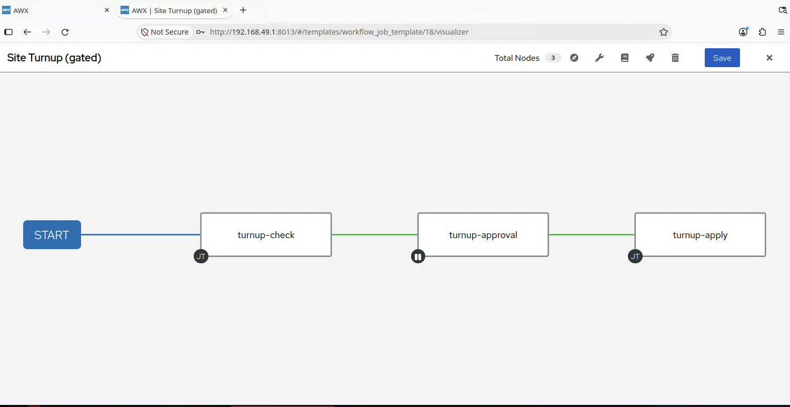

# Lab 4 — Event-driven, with an approval gate

**50 minutes.** Goal: a change in Nautobot triggers automation, and a human approves it before anything touches a device.

By the end, you'll have flipped a device's status in Nautobot, watched a workflow start on its own, approved it yourself, and found the whole story in the change log.

> **Where you'll be working.** 🤖 Nautobot · ⚙️ AWX · 💻 Terminal — every step below says which. This lab moves between the two browser tabs constantly; you'll barely need the terminal.

---

## Why this lab exists

Everything so far needed a person to start it. Real change processes don't work that way; something happens, automation responds, and *someone with authority signs off before it lands*.

That last part is what most demos skip. Auto-remediation is a great story until you work somewhere that legally cannot do it. Most regulated shops cannot let automation change production unattended. They need a gate, an approver, and a record.

That's this lab, and it's the reason the workshop exists.

---

## 4a. 🤖 Nautobot — what fires the trigger

🤖 **Extensibility → Webhooks** → `device-status-change`.

| Field | Value | Why |
| --- | --- | --- |
| **Object types** | `dcim.device` | Only device changes |
| **Type update** | ✅ | Fires on edit, not on create or delete |
| **URL** | AWX's workflow launch endpoint | `/api/v2/workflow_job_templates/N/launch/` |
| **HTTP method** | `POST` |  |
| **Additional headers** | an `Authorization: Bearer` line | An AWX API token. Nautobot has to authenticate like any other client. |
| **Body template** | Jinja2 | Passes the device name through, plus who changed it and when |

Read the body template. It's Jinja2, rendered by Nautobot at send time:

```jinja
{
  "extra_vars": {
    "device_name": "{{ data.name }}",
    "changed_by": "{{ username }}",
    ...
  },
  "limit": "{{ data.name }}"
}
```

`limit` is what stops the workflow from acting on every device in the inventory. Without it, one device edit would reconfigure the whole fleet.

## 4b. 🤖 The condition that isn't there

Look again. There is no condition field.

That's not an oversight in the lab setup — Nautobot's webhook model doesn't have one. Any device edit fires this webhook: a description change, a rename, a tag.

So where does the filtering go? Into the automation. The first node of the workflow asks Nautobot what the device's status is *now* and stops if it isn't `Active`.

That's worth sitting with for a second, because it's a better design than a condition field would be:

- A webhook is a notification, not data. It says *something changed*.
- By the time the worker delivers it, it may already be stale; for example, someone can change the status twice while it sits in the queue.
- So the automation asks the source of truth what's true now, rather than trusting a message about what was true then.

That's the same argument this whole workshop makes, turned on itself.

> The alternative is a **Job Hook** — a Nautobot Job that runs on change, with real Python to decide. That's the "when the logic belongs in Nautobot" answer, and it's one of the things we'll come back to in the closing segment.

## 4c. ⚙️ AWX — what receives it

⚙️ **Resources → Templates → `Site Turnup (gated)`**. Open the **Visualizer**.



```
[ 1. check and diff ]  →  [ ⏸ 2. Approve site turn-up ]  →  [ 3. apply and write back ]
```

| Node | What it does |
| --- | --- |
| **1. Site Turnup - check and diff** | Re-reads the status from Nautobot, stops if it isn't `Active`, then renders intent and diffs it in check mode |
| **2. Approve site turn-up** | Runs no code. Waits for a human. |
| **3. Site Turnup - apply and write back** | Applies what node 1 showed, then writes discovered state back to Nautobot |

Two things about that shape are deliberate:

**The diff happens before the gate.** The approver isn't asked "may automation run?" — they're shown the exact lines that would be sent, and asked to approve *those*. An approval gate with nothing to read is a rubber stamp.

**Nodes 1 and 3 run the same code.** Node 1 runs it in check mode; node 3 sets one variable and runs it for real. So the change that gets applied is the change that was shown — not a second playbook that might have drifted.

The arrows are **on success**. If node 1 decides this wasn't a turn-up, nobody gets asked to approve anything.

## 4d. 🤖 Fire it

🤖 **Devices → `leaf2` → Edit** → set **Status** to `Active` → **Save**.

That's the whole trigger; a normal, boring edit that someone would make anyway. You didn't open AWX, you didn't run a command, you didn't fill in a form.

## 4e. ⚙️ Watch it start on its own

⚙️ **Views → Jobs**.

A workflow is running that nobody launched. Open it and switch to the **Visualizer** or **Details** view.

Node 1 runs first. Open its output and find:

```
Device:          leaf2
Status now:      Active
Changed by:      admin
```

Nautobot told AWX a device changed. AWX asked Nautobot what it changed *to*.

Then the diff — the same output shape you saw in Lab 2.

## 4f. ⚙️ It stops and waits

The workflow awaits for approval. Nothing has touched a device. The change has been calculated and is sitting there for a human to look at.

Scroll back through node 1's output and read the lines it says it would send. That's the change being proposed, not a description of it, the actual commands.

## 4g. ⚙️ Approve

⚙️ **Views → Workflow Approvals**. Or, go to the respective node of the workflow.
Click **Approve**.

Node 3 runs: applies the config, then writes state back to Nautobot as in Lab 3.

> **Try Deny on a later run.** The workflow stops, node 3 never starts, the record shows who denied it and when, and nothing changed. A refusal is as auditable as an approval which is the half of this that compliance people actually ask about.

## 4h. ⚙️ A second workflow appears, and immediately stops

Watch **Views → Jobs** for a moment after node 3 finishes. A second `Site Turnup (gated)` starts on its own, fails at node 1, and goes no further.

That is not a bug. It is the most important thing in this lab.

Node 3 wrote state *back into Nautobot:* serial, software version, the custom fields. A device update is exactly what the webhook fires on**.** So the automation triggered itself:

```
status → Active ─→ webhook ─→ workflow ─→ approve ─→ write-back
                      ↑                                   │
                      └──────── device updated ───────────┘
```

Left alone, that is an infinite loop: approve once and you are asked to approve forever. It is the classic failure of event-driven automation, and it is easy to build by accident because every piece of it is individually reasonable.

However, in our setup, Node 1 stops it**.** Open the failed one and read the message: the event changed the device, but it did not change the *status*, so this is an echo of our own write-back rather than a new turn-up. The webhook payload carries which fields actually moved, and node 1 checks.


| The loop | Why |
| --- | --- |
| **What makes it possible** | A webhook with no condition, firing on every update |
| **What makes it stop** | The automation knowing what it itself just did |

Notice where that knowledge lives. Not in Nautobot — it *can't* be, there's no condition field. It's in the first node of the workflow. An event-driven system needs somewhere to decide, and if the event source can't decide, the automation must**.** That's a design obligation, not a detail; skip it and you ship the loop.

## 4i. 🤖 The full story, in one place

🤖 **Devices → `leaf2` → Change Log**.

You'll see two entries, and the pair is the point:

| Entry | What it tells you |
| --- | --- |
| The status change | The trigger based on what a human did, and who |
| The write-back | The consequence of what automation did, carrying `awx_job_id` |

From the source of truth alone you can now answer:

- **What changed** on the device
- **What triggered it** and who made that edit
- **Which job did the work** via the AWX job ID
- **Who approved it** in the linked AWX workflow

That's the audit trail. Not a log file someone greps six months later but a record in the system of record, linked to the automation run that produced it, linked to the human who authorized it.

---

## Why this is different from auto-remediation

You'll see plenty of demos where a system detects drift and fixes it. That's real and useful, and unavailable to a lot of people.

| Property | Auto-remediation | This |
| --- | --- | --- |
| Reacts to events | ✅ | ✅ |
| Human in the loop | ❌ | ✅ |
| Reviewable before it lands | ❌ | ✅ |
| Record of who authorized | ❌ | ✅ |
| Allowed in a change-controlled shop | usually ❌ | ✅ |

---

## What just changed

| Before | After |
| --- | --- |
| A person starts automation | An event starts it |
| Change lands immediately | Change waits for approval |
| Approval lives in a ticket, elsewhere | Approval is in the execution record |
| "Who authorized this?" — ask around | In the change log |

---

## Stretch goals

**1. ⚙️ Approval timeout.** The approval node waits indefinitely. Set its timeout to two minutes, trigger it, and let it expire. What state does the workflow end in, and is that what you'd want at 2am?

**2. 🤖 Make it not fire.** Change `leaf2`'s description and save. The webhook fires anyway; watch node 1 stop the workflow. Then decide: is a failed node the right way to express "not interesting", or would you rather this never left Nautobot?

**3. 🤖 Do it differently with a Job Hook.** Replace the webhook with a Job Hook which is a Nautobot Job that runs on change and decides in Python whether to call AWX at all. Lab 3's `jobs/launch_awx.py` is most of the code already.

**4. 🤖 Link the two systems.** Add a Nautobot **Custom Link** on the device that deep-links to the AWX job in `awx_job_id`. One click from "what changed" to "what did it".

**5. ⚙️ Deny, and inspect.** Trigger it, deny it, and find every place that refusal is recorded.

---

## Stuck?

| Where | Symptom | Likely cause |
| --- | --- | --- |
| ⚙️ | Nothing happens on status change | The webhook target or its token |
| ⚙️ | A second workflow appears and fails at node 1 | Working as designed — that is the write-back echoing back through the webhook. |
| ⚙️ | Approvals keep appearing after you approve | A loop. Node 1's status check is not running |
| ⚙️ | Node 1 fails: *"is 'Planned', not 'Active'"* | Working as designed. The edit wasn't a turn-up. Set the status to `Active`. |
| ⚙️ | Node 1 fails: *"No device&#95;name was supplied"* | You launched the workflow by hand instead of triggering it. Edit the device in Nautobot instead. |
| ⚙️ | Workflow runs against both leaves | The `limit` didn't arrive |
| ⚙️ | Node 1 fails on the diff | Same causes as Lab 2, the device is unreachable |
| ⚙️ | No Approve button | You may lack permission on the approval node |
| ⚙️ | Approved, but nothing changed | Check node 3's output |
| 🤖 | Change log has no job ID | Node 3 didn't run, check the workflow |

---

## Wrapping up

You started where many automated networks are today: Ansible and AWX already running changes, with the data they needed kept in files and typed into forms. Over four labs, Nautobot took over each of those pieces:

| Lab | What moved into Nautobot |
| --- | --- |
| 1 — Inventory | Which devices exist, and which ones a job targets |
| 2 — Intent | The variables, checked by a schema and fetched in one query |
| 3 — Write-back | What the devices report about themselves, and a button that launches AWX |
| 4 — Approval | The trigger for a change, with a person approving it before it lands |

The playbook stayed the same all the way through. What changed is where its data comes from and what starts it.

Other tools worth a look. The same ideas carry over to other tools, and each one suits a slightly different problem. Now that you've built the whole flow once, these make good next experiments:

| Tool | Worth a look when… |
| --- | --- |
| **Nautobot Jobs** | You want the logic to live next to the data. A Job is Python that runs inside Nautobot, with direct access to its data model, permissions and change log. Lab 3's "Run in AWX" button is one. |
| **Nornir** | You prefer plain Python to playbooks, or need to work across many devices concurrently. It's a library rather than a platform, so you choose how it is scheduled and run. |
| **Golden Config** | Configuration backup, intended configs and compliance reporting are the main goal. It's a Nautobot app that does what you did by hand in Lab 2, rendering intent and comparing it with the device, with history and reports built in. |

These sit alongside an orchestration layer rather than replacing it. What AWX added today was the process around the work: an approval before a change lands, control over who may run what, credentials the person launching a job never sees, the same execution environment on every run, and a record of each run. Whichever tools you choose, those are the questions worth asking: which of them you need, and where they should live.

---

**Taking it home.** Everything you used today is in a repository you keep — the playbooks, the templates, the GraphQL queries, the Nautobot Job — plus the notes you'd need to rebuild this environment yourself.

---

⬅️ [Lab 3](./lab3-writeback.md)  

🎉 **That's the workshop. Thanks for spending this time on it.**
